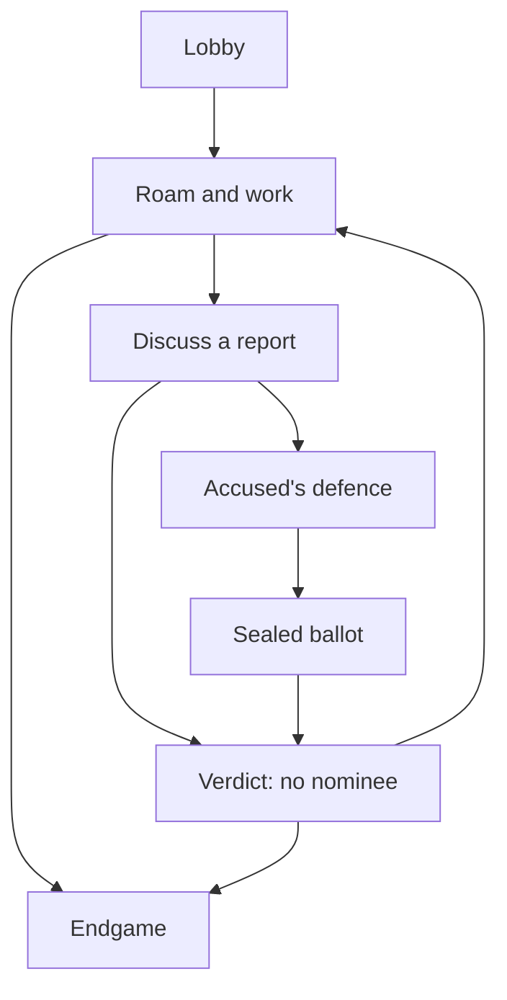

# Code boundaries and invariants

`sim/engine.js` is deterministic for a seed and action sequence. It has no DOM, Three.js, PeerJS, localStorage, network or filesystem access. It consumes fixed host timesteps. Shared profile sanitization is a pure function in `src/profile.js`; storage is called only by the UI.

`net/authority.js` authenticates the *connection binding*, validates packet envelopes and calls the rules. `net/session.js` owns PeerJS connections, heartbeats, the simulation timer and teardown. Only an explicitly offline Session creates `PracticeBots`. Bots use the same actions and collision rules as humans; their steering is intentionally simple and can get stuck around scenery.

`render/world.js` consumes snapshots. It cannot award currency or set contracts. It loads original models from the GLB, builds the landscape, interpolates actors, animates limbs, orbits the third-person camera and displays the public elimination. Death is a falling lantern/fading character, not graphic violence. The renderer follows the first living villager when the local player is eliminated. `ui/interface.js` escapes player-written names and chat before inserting markup. Local profile storage only accepts an explicit cosmetic allow-list.

State machine:

Only roam permits contracts and reports. Reports cancel any existing contract. A fresh delay starts after a trial ends. Timers and the match time cap are host-owned. A normal deadline may end a trial without conviction; an active verdict's short presentation is allowed to finish before the next endgame check. An already-met survivor condition can end a match after a murder without a further trial.

Contract invariant: zero or one `{assassinId, targetId, expiresAt}` object in host memory. No array of pending contracts is exposed. Target and holder must be living, connected and different. Death/disconnection cancels an associated contract. The public serializer does not have contract, target, RNG, next-assignment or ballot-map fields. Witness/evidence strings only enter the public trial when a body is reported. Raw votes never broadcast; only counts and the recipient's own selection are sent.

Votes are immutable once sealed. Every living connected villager at ballot opening, including the accused, enters the electorate. `floor(electorate.length / 2) + 1` guilty votes are required. Abstentions are not implicitly guilty. An even split never eliminates. After a disconnect the denominator stays fixed, preventing a changed majority threshold mid-ballot.

Pairing invariant: a player can be queued or in one pair. Selection removes two random queue entries. Both players must be alive, connected, ready and within range for three continuous seconds. Leaving the range resets progress. Completion pays each exactly once and removes the pair. Death or disconnection cleans up both partners. Solo-job and co-op coins belong only to this match and do not unlock persistent items.

## Deliberate limits

No public matchmaking, passwords, authoritative server, cheat resistance, mobile touch controller, full accessibility replacement for 3D navigation, cross-device cosmetic accounts, durable economy, monetization, matchmaking service, moderation service or analytics. Text chat exists only during trials. All online players must agree to trust the host. Grass is instanced and static scenery is batched by material; use low power mode for weaker hardware and profile on actual devices before expanding the scene. No frame-rate target has yet been verified.
